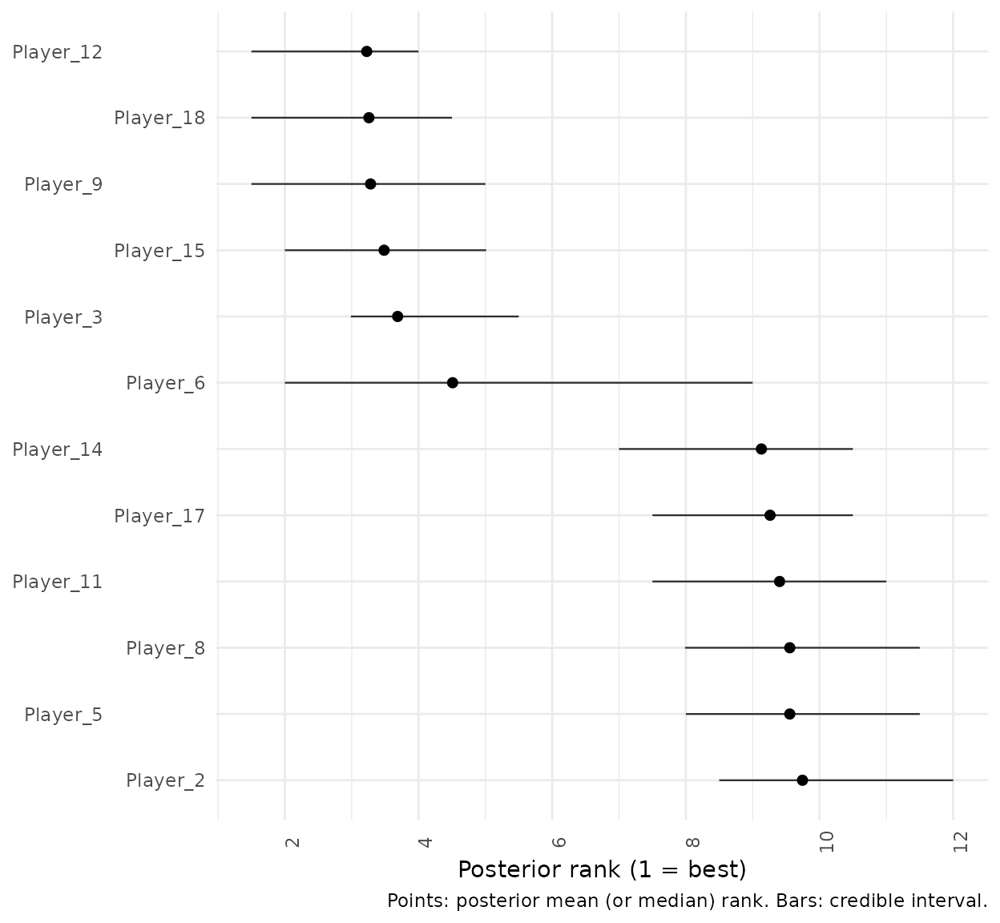
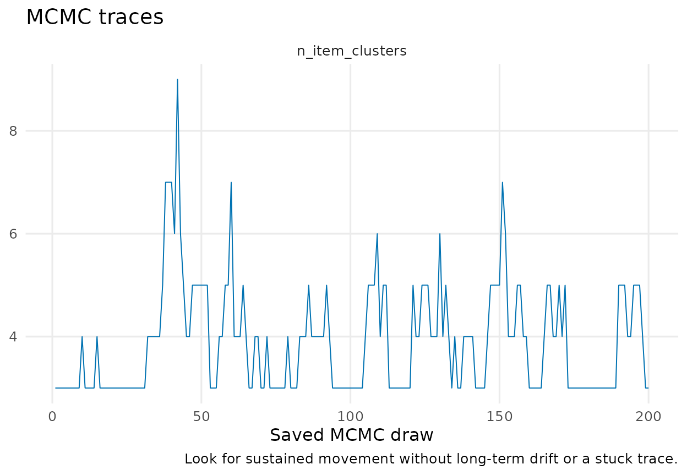

# Package 'RBBayes'

## `BTSBM-package`: Bayesian paired-comparison and ranking models with latent blocks

**Description**

RBBayes provides Bayesian Bradley–Terry and Plackett–Luce models through
one data–model–fit interface. This vignette focuses on the Bradley–Terry
stochastic block model (BT–SBM), in which items with similar competitive
strength share an ordered latent block. The model learns block
membership, block strength, and the number of occupied blocks jointly.

**Details**

Pairwise-comparison data record directional outcomes between items: a
player defeats an opponent, a judge prefers one object to another, or
one system wins an evaluation. The classical Bradley–Terry model assigns
every item its own positive strength and therefore induces a strict
order. That resolution can be too fine when nearby items are not
credibly separable.

The BT–SBM instead assigns item \\i\\ to a latent block \\z_i\\. Items
in the same block share a strength \\\lambda\_{z_i}\\; occupied blocks
are ordered by strength. The result is a probabilistic tiered ranking
rather than a forced item-by-item ordering. Posterior output keeps
uncertainty visible through a distribution over the number of blocks, a
block-ordered outcome matrix, conditional assignment probabilities, and
rank intervals.

The public workflow has four stages: prepare data, specify a model, set
MCMC controls, and fit. The same fit class is then consumed by
summaries, plots, diagnostics, and predictive-comparison functions.

**Quick start**

``` r

wins <- ATP_2000_2025$`2017`$Y_ij
diag(wins) <- 0L

pairwise <- as_bt_data(wins)
model <- bt_sbm_model(
  shape_lambda = 2, rate_lambda = exp(digamma(2)),
  item_clustering = gnedin_prior(gnedin_hyper = 0.8)
)
fit <- fit_model(
  pairwise,
  model,
  mcmc_control(iter = 2000, warmup = 1000, seed = 1)
)

pretty_table_K_distribution(fit, p_min = 0)
plot_block_adjacency(fit)
plot_assignment_probabilities(fit)
```

**Authors**

Lapo Santi and Nial Friel.

**References**

Bradley, R. A. and Terry, M. E. (1952). Rank analysis of incomplete
block designs: I. The method of paired comparisons. *Biometrika*,
39(3/4), 324–345.

Santi, L. and Friel, N. (2026). The Bradley–Terry stochastic block
model. *The Annals of Applied Statistics*, 20(2), 1766–1787.

## `as_bt_data`: Create validated Bradley–Terry pairwise data

**Description**

[`as_bt_data()`](https://laposanti.github.io/BTSBM/reference/as_bt_data.md)
converts a square directed win-count matrix into the validated
pairwise-data representation used by the common fitting interface.

**Usage**

``` r

as_bt_data(wins, item_labels = NULL)
```

**Arguments**

| Argument | Description |
|----|----|
| `wins` | Numeric square matrix. `wins[i, j]` is the number of wins for item \\i\\ over item \\j\\. The diagonal must be zero. |
| `item_labels` | Optional character vector of item names. Matrix row names are used by default when available. |

**Value**

An object of class `btsbm_pairwise_data`. It contains the validated
directed win matrix and labels required by the fitting and plotting
methods.

**Details**

Let \\w\_{ij}\\ be the number of times item \\i\\ defeats item \\j\\,
with \\w\_{ii}=0\\, and define \\n\_{ij}=w\_{ij}+w\_{ji}\\. RBBayes
stores the matrix \\\mathbf W=(w\_{ij})\\ in the object returned by
[`as_bt_data()`](https://laposanti.github.io/BTSBM/reference/as_bt_data.md)
and computes match totals internally.

**Example**

This vignette uses one synthetic league throughout. It contains 18
players generated from three strength tiers.

``` r

simulation <- sample_from_BTSBM(
  n_players = 18,
  K = 3,
  mean_matches = 8,
  p_edge = 0.75,
  lambda = c(0.25, 0.9, 2.4),
  reverse_lambda = FALSE,
  seed = 123
)

player_labels <- paste0("Player_", seq_len(nrow(simulation$w)))
pairwise <- as_bt_data(simulation$w, item_labels = player_labels)
pairwise$wins[1:6, 1:6]
#>          Player_1 Player_2 Player_3 Player_4 Player_5 Player_6
#> Player_1        0        1        0        0        0        0
#> Player_2        5        0        1        6        0        0
#> Player_3        0        6        0        0        5        2
#> Player_4        5        2        0        0        0        0
#> Player_5        0        0        4       12        0        0
#> Player_6        0        0        5        0        5        0
```

## `bt_sbm_model`: Define a Bradley–Terry stochastic block model

**Description**

[`bt_sbm_model()`](https://laposanti.github.io/BTSBM/reference/bt_sbm_model.md)
defines a clustered Bradley–Terry model. The simple model is defined
with
[`bt_model()`](https://laposanti.github.io/BTSBM/reference/bt_model.md).
Both constructors return a `btsbm_model` and are fitted by
[`fit_model()`](https://laposanti.github.io/BTSBM/reference/fit_model.md).

**Usage**

``` r

bt_sbm_model(
  shape_lambda = 4,
  rate_lambda = exp(digamma(shape_lambda)),
  item_clustering = gnedin_prior(gnedin_hyper = 0.5),
  latent_strength = NULL,
  ability_prior = NULL,
  item_prior = NULL
)
```

**Arguments**

| Argument | Description |
|----|----|
| `shape_lambda`, `rate_lambda` | Gamma prior for the block strengths: \\\lambda_k \sim\\ iid Gamma(shape_lambda, rate_lambda). |
| `item_clustering` | Prior on the latent item partition \\z\\. |
| `latent_strength`, `ability_prior` | Deprecated: a prior object from [`latent_strength()`](https://laposanti.github.io/BTSBM/reference/latent_strength.md). |
| `item_prior` | Deprecated alias for `item_clustering`. |

**Value**

A `btsbm_model` specification. It records scientific choices without
starting the sampler.

**Details**

Each item has a block label \\z_i\in\\1,\ldots,K\\\\ and each occupied
block has a positive strength \\\lambda_k\\. The probability of a win is

\\ \Pr(i\text{ defeats }j\mid x,\lambda)
=\frac{\lambda\_{z_i}}{\lambda\_{z_i}+\lambda\_{z_j}}, \\

so the aggregated observation satisfies

\\ w\_{ij}\mid n\_{ij},x,\lambda \sim\operatorname{Binomial}\\\left(
n\_{ij},\frac{\lambda\_{z_i}}{\lambda\_{z_i}+\lambda\_{z_j}} \right). \\

The prior over \\x=(x_1,\ldots,x_n)\\ is a named model component rather
than a collection of sampler-specific arguments.

| Scientific choice | Constructor |
|----|----|
| Random finite number of blocks | `gnedin_prior(gnedin_hyper = 0.8)` |
| Dirichlet-process partition | `dirichlet_process_prior(concentration = 1)` |
| Pitman–Yor partition | `pitman_yor_prior(concentration = 1, discount = 0.2)` |
| Fixed upper bound | `finite_partition(max_clusters = 4, concentration = 1)` |

**Examples**

``` r

model_gnedin <- bt_sbm_model(
  shape_lambda = 2, rate_lambda = exp(digamma(2)),
  item_clustering = gnedin_prior(gnedin_hyper = 0.8)
)

model_finite <- bt_sbm_model(
  item_clustering = finite_partition(max_clusters = 6)
)
```

## `mcmc_control`: Set MCMC controls for an RBBayes fit

**Description**

[`mcmc_control()`](https://laposanti.github.io/BTSBM/reference/mcmc_control.md)
collects computational settings separately from the model specification.
This makes it possible to reuse the same scientific model with different
chain lengths, seeds, or initial states.

**Usage**

``` r

mcmc_control(
  iter = 2000,
  warmup = floor(iter / 2),
  seed = NULL,
  store = c("minimal", "augmented"),
  init_item_cluster = NULL,
  init_ranking_cluster = NULL,
  verbose = FALSE,
  progress_every = 1000L,
  partition_moves = NULL
)
```

**Arguments**

| Argument | Description |
|----|----|
| `iter` | Total number of MCMC iterations. |
| `warmup` | Number of initial iterations discarded as warmup. |
| `seed` | Optional integer seed for reproducibility. |
| `store` | Store the minimal state or also keep latent augmentations. |
| `init_item_cluster` | Optional initial item partition. |
| `init_ranking_cluster` | Optional initial ranking partition for PL mixture and PL–LBM models. |
| `verbose`, `progress_every` | Control progress reporting. |
| `partition_moves` | Optional settings created by [`partition_moves()`](https://laposanti.github.io/BTSBM/reference/partition_moves.md). |

**Value**

An object of class `btsbm_mcmc_control`.

**Example**

``` r

control <- mcmc_control(iter = 400, warmup = 200, seed = 124)
control
```

## `fit_btsbm`: Fit a Bayesian Bradley–Terry or Plackett–Luce model

**Description**

[`fit_model()`](https://laposanti.github.io/BTSBM/reference/fit_model.md)
is the common fitting entry point for the simple and clustered
Bradley–Terry and Plackett–Luce models.

**Usage**

``` r

fit_model(data, model, control = mcmc_control())
```

**Arguments**

| Argument | Description |
|----|----|
| `data` | A `btsbm_pairwise_data` or `btsbm_ranking_data` object created by [`as_bt_data()`](https://laposanti.github.io/BTSBM/reference/as_bt_data.md) or [`as_rankings()`](https://laposanti.github.io/BTSBM/reference/as_rankings.md). |
| `model` | A model object created by an RBBayes model constructor. |
| `control` | An object created by [`mcmc_control()`](https://laposanti.github.io/BTSBM/reference/mcmc_control.md). |

**Value**

An object of class `btsbm_fit`. Its stable draw names allow the same
downstream summary and diagnostic functions to work across supported
models.

**Details**

The internal BT–SBM kernel alternates three updates. A Thurstonian
augmentation introduces latent \\Z\_{ij}\\ variables for observed pairs.
Item labels are then updated one at a time using the selected partition
prior and the augmented likelihood. Finally, occupied strengths have
conjugate Gamma updates. The number of occupied blocks may change during
the label update, so \\K\\ is sampled rather than fixed.

Cluster labels are permutation-invariant. For the summaries in this
vignette, each draw is relabelled by decreasing occupied strength: block
1 is strongest, block 2 is second strongest, and so forth. Users do not
need to call a separate relabel step when using the `btsbm_fit`
functions documented below.

**Example**

``` r

model <- bt_sbm_model(
  shape_lambda = 2, rate_lambda = exp(digamma(2)),
  item_clustering = gnedin_prior(gnedin_hyper = 0.8)
)

fit <- fit_model(pairwise, model, control)
fit
#> <btsbm_fit> Bradley-Terry stochastic block model (BT-SBM), items share block strengths 
#>   18 items; 200 retained posterior draws. Use summary() for results.
```

``` r

str(list(
  item_cluster = dim(fit$draws$item_cluster),
  n_item_clusters = length(fit$draws$n_item_clusters),
  latent_strength = length(fit$draws$latent_strength)
))
#> List of 3
#>  $ item_cluster   : int [1:2] 200 18
#>  $ n_item_clusters: int 200
#>  $ latent_strength: int 200
```

## `pretty_table_K_distribution`: Format the posterior distribution of occupied blocks

**Description**

This function produces a compact horizontal table of the posterior
distribution of \\K\\, the number of occupied item blocks. A complete
distribution is usually more informative than its mode alone.

**Usage**

``` r

pretty_table_K_distribution(
  post,
  format = "html",
  p_min = 0,
  digits = 3,
  latex_options = "hold_position"
)
```

**Arguments**

| Argument | Description |
|----|----|
| `post` | A `btsbm_fit` with an item partition, or relabelled output. |
| `format` | Output format, usually `"html"` or `"latex"`. |
| `p_min` | Drop probabilities no larger than this threshold. |
| `digits` | Number of digits used to display probabilities. |
| `latex_options` | Styling options passed to `kableExtra` for LaTeX output. |

**Value**

A `knitr_kable` object suitable for the requested document format.

**Example**

``` r

pretty_table_K_distribution(
  fit,
  format = if (knitr::is_latex_output()) "latex" else "html",
  p_min = 0
)
```

| Quantity              |     3 |     4 |     5 |     6 |     7 |     9 |
|:----------------------|------:|------:|------:|------:|------:|------:|
| Posterior probability | 0.475 | 0.275 | 0.195 | 0.025 | 0.025 | 0.005 |

## `plot_block_adjacency`: Display outcomes in posterior block order

**Description**

[`plot_block_adjacency()`](https://laposanti.github.io/BTSBM/reference/plot_block_adjacency.md)
draws observed win rates after ordering items by a representative
posterior partition and then by marginal win proportion within each
block. Boundary lines and the coloured side band mark block transitions.

**Usage**

``` r

plot_block_adjacency(
  fit,
  w_ij = NULL,
  x_hat = NULL,
  relabel_blocks = c("none", "avg_lambda"),
  lambda_hat = NULL,
  relabel_decreasing = TRUE,
  clean_fun = clean_players_names,
  players_df = NULL,
  players_id_col = NULL,
  labels = NULL,
  labels_key_col = NULL,
  labels_value_col = NULL,
  clean_display_labels = NULL,
  order_ids = NULL,
  palette = NULL,
  fill_low = "#FFFFCC",
  fill_high = "#006400",
  no_match_label = "No match played",
  no_match_color = "white",
  mark_unplayed = TRUE,
  unplayed_mark = "×",
  unplayed_mark_size = 2.2
)
```

**Arguments**

| Argument | Description |
|----|----|
| `fit` | A BT–SBM `btsbm_fit` object, or compatible relabelled output. |
| `w_ij`, `x_hat` | Optional win matrix and partition estimate; these are normally obtained from `fit`. |
| `relabel_blocks`, `lambda_hat`, `relabel_decreasing` | Optional controls for ordering block labels by average strength. |
| `clean_fun` | Optional function used to tidy display labels. |
| `labels` | Optional display labels, either named by item ID or aligned with items. |
| `players_df`, `players_id_col`, `labels_key_col`, `labels_value_col`, `clean_display_labels` | Optional metadata-based label lookup and cleaning controls. |
| `order_ids` | Optional explicit ordering of item IDs. |
| `palette` | Optional named vector of block colours. |
| `fill_low`, `fill_high` | Endpoints of the observed-win-rate colour scale. |
| `no_match_label`, `no_match_color` | Legend label and colour for pairs with no observed match. |
| `mark_unplayed`, `unplayed_mark`, `unplayed_mark_size` | Control the optional marker drawn over unplayed pairs. |

**Value**

A `ggplot` object. Each matrix cell is the observed win rate
\\w\_{ij}/n\_{ij}\\, not a posterior fitted probability.

**Example**

``` r

plot_block_adjacency(fit, clean_fun = identity)
```


Observed win rates reordered by the representative posterior partition.
Boundary lines and the side band mark inferred blocks.

## `plot_assignment_probabilities`: Display posterior uncertainty over block membership

**Description**

This heatmap shows item-wise posterior assignment probabilities after
ordering blocks by decreasing strength. By default, probabilities are
conditional on the modal sampled value of \\K\\. This separates
uncertainty about which block an item occupies from uncertainty about
how many blocks exist.

**Usage**

``` r

plot_assignment_probabilities(
  fit,
  w_ij = NULL,
  max_n_clust = NULL,
  players_df = NULL,
  players_id_col = NULL,
  labels = NULL,
  labels_key_col = NULL,
  labels_value_col = NULL,
  clean_display_labels = NULL,
  clean_fun = clean_players_names,
  x_hat = NULL,
  order_ids = NULL,
  k_show = NULL,
  fill_low = "#FFFFCC",
  fill_high = "#006400"
)
```

**Arguments**

| Argument | Description |
|----|----|
| `fit` | A BT–SBM `btsbm_fit` object, or compatible relabelled output. |
| `w_ij` | Optional win matrix used for ordering and annotation; it is normally obtained from `fit`. |
| `max_n_clust` | Occupied-cluster count on which probabilities are conditioned; the posterior mode is used by default. |
| `labels`, `clean_fun` | Optional display labels and a function for tidying them. |
| `players_df`, `players_id_col`, `labels_key_col`, `labels_value_col`, `clean_display_labels` | Optional metadata-based label lookup and cleaning controls. |
| `x_hat`, `order_ids` | Optional controls for item order. |
| `k_show` | Compatibility alias for `max_n_clust`. |
| `fill_low`, `fill_high` | Endpoints of the probability colour scale. |

**Value**

A `ggplot` object. A diffuse row indicates that an item lies near a
posterior block boundary.

**Example**

``` r

plot_assignment_probabilities(fit, clean_fun = identity)
```


Posterior block-membership probabilities conditional on the modal number
of occupied blocks.

## `plot_rank_intervals`: Plot posterior rank intervals

**Description**

Because all items in a block share a strength, their induced ranks are
tied.
[`plot_rank_intervals()`](https://laposanti.github.io/BTSBM/reference/plot_rank_intervals.md)
summarizes posterior ordering without inventing within-block precision.

**Usage**

``` r

plot_rank_intervals(
  x,
  max_players = NULL,
  w_ij = NULL,
  player_names = NULL,
  burn_in = 0,
  thin = 1,
  ci = 0.95,
  ties.method = "average",
  rank_grid_by = 0.5
)
```

**Arguments**

| Argument | Description |
|----|----|
| `x` | A posterior-rank summary, posterior strength draws, a `btsbm_fit`, or compatible relabelled output. |
| `max_players` | Optional maximum number of items displayed. |
| `w_ij`, `player_names` | Optional data and labels used when rank summaries must be computed. |
| `burn_in`, `thin` | Optional post-processing controls for supplied draws. |
| `ci` | Posterior interval level. |
| `ties.method` | Method passed to [`base::rank()`](https://rdrr.io/r/base/rank.html). |
| `rank_grid_by` | Spacing of the posterior-rank probability grid. |

**Value**

A `ggplot` object.

**Example**

``` r

plot_rank_intervals(fit, max_players = 12)
```



## `mcmc_diagnostics`: Summarise mixing and inspect saved traces

**Description**

[`mcmc_diagnostics()`](https://laposanti.github.io/BTSBM/reference/mcmc_diagnostics.md)
computes lightweight scalar diagnostics, while
[`plot_mcmc_traces()`](https://laposanti.github.io/BTSBM/reference/plot_mcmc_traces.md)
shows whether saved draws move around a stable region. Trace plots are
an initial diagnostic, not proof of convergence.

**Usage**

``` r

mcmc_diagnostics(fit)
plot_mcmc_traces(fit, quantities = NULL)
```

**Arguments**

| Argument     | Description                                                |
|--------------|------------------------------------------------------------|
| `fit`        | A `btsbm_fit` object.                                      |
| `quantities` | Optional character vector naming scalar traces to display. |

**Value**

[`mcmc_diagnostics()`](https://laposanti.github.io/BTSBM/reference/mcmc_diagnostics.md)
returns a data frame with effective sample size, Monte Carlo standard
error, and lag-one autocorrelation for each available scalar trace.
[`plot_mcmc_traces()`](https://laposanti.github.io/BTSBM/reference/plot_mcmc_traces.md)
returns a `ggplot` object.

**Example**

``` r

mcmc_diagnostics(fit)
#>          quantity mean       sd      ess      mcse autocorrelation_lag_1
#> 1 n_item_clusters 3.87 1.052921 35.20167 0.1774656              0.699808
plot_mcmc_traces(fit)
```



The short chain used here keeps the vignette quick to build. A
scientific analysis should use longer independent chains and assess
their agreement.

## `loo_btsbm`: Run predictive comparison for a fitted model

**Description**

[`loo_btsbm()`](https://laposanti.github.io/BTSBM/reference/loo_btsbm.md)
runs Pareto-smoothed importance-sampling leave-one-out cross-validation
using the pointwise log likelihood stored by the common fit interface.

**Usage**

``` r

loo_btsbm(fit, ...)
```

**Arguments**

| Argument | Description |
|----|----|
| `fit` | A `btsbm_fit` object. |
| `...` | Additional arguments passed to [`loo::loo()`](https://mc-stan.org/loo/reference/loo.html). |

**Value**

A `loo` object. Models can be compared with
[`loo::loo_compare()`](https://mc-stan.org/loo/reference/loo_compare.html)
when they use the same observations.

**Example**

``` r

simple_fit <- fit_model(
  pairwise,
  bt_model(shape_lambda = 2, rate_lambda = exp(digamma(2))),
  mcmc_control(iter = 400, warmup = 200, seed = 125)
)

if (requireNamespace("loo", quietly = TRUE)) {
  loo::loo_compare(list(
    simple = loo_btsbm(simple_fit),
    clustered = loo_btsbm(fit)
  ))
} else {
  "Install 'loo' to run the predictive comparison."
}
#>      model elpd_diff se_diff p_worse diag_diff        diag_elpd
#>  clustered       0.0     0.0      NA           38 k_psis > 0.57
#>     simple      -4.5     3.5    0.90            5 k_psis > 0.57
```

## `BTSBM-design`: Software architecture, assumptions, and scope

**Software design**

The public architecture separates five responsibilities:

1.  [`as_bt_data()`](https://laposanti.github.io/BTSBM/reference/as_bt_data.md)
    and
    [`as_rankings()`](https://laposanti.github.io/BTSBM/reference/as_rankings.md)
    validate observations.
2.  Model constructors state the likelihood and latent structure.
3.  Prior constructors state reusable strength and partition priors.
4.  [`mcmc_control()`](https://laposanti.github.io/BTSBM/reference/mcmc_control.md)
    holds computational settings.
5.  [`fit_model()`](https://laposanti.github.io/BTSBM/reference/fit_model.md)
    returns a common fit consumed by summaries, plots, diagnostics, and
    [`log_lik()`](https://laposanti.github.io/BTSBM/reference/log_lik.md).

This contract also covers the package’s Plackett–Luce models. The
model-specific sampler remains an implementation detail, so analyses do
not need different extraction and plotting code merely because the
likelihood changes.

**Assumptions and limitations**

The Bradley–Terry likelihood assumes one transitive strength dimension
and conditions on the observed comparison counts. The current core model
does not include pair-specific covariates, temporal dependence, surface
effects, or other contextual predictors. Partition priors are
exchangeable. These assumptions should be checked against the scientific
setting before interpreting inferred tiers.

**Conclusion**

RBBayes provides a coherent Bayesian workflow for pairwise outcomes when
a strict ranking is more precise than the evidence supports. The
posterior distribution over \\K\\, the block-ordered adjacency matrix,
and conditional assignment probabilities jointly show the inferred
hierarchy and the uncertainty around its resolution and boundaries.

**References**

Caron, F. and Doucet, A. (2012). Efficient Bayesian inference for
generalized Bradley–Terry models. *Journal of Computational and
Graphical Statistics*, 21(1), 174–196.

Vehtari, A., Gelman, A., and Gabry, J. (2017). Practical Bayesian model
evaluation using leave-one-out cross-validation and WAIC. *Statistics
and Computing*, 27, 1413–1432.
